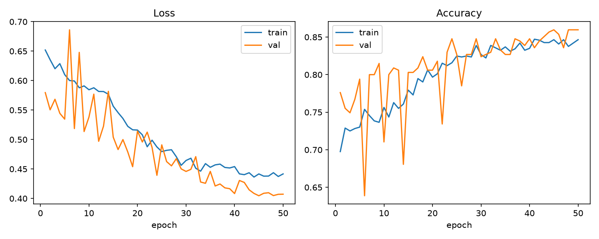
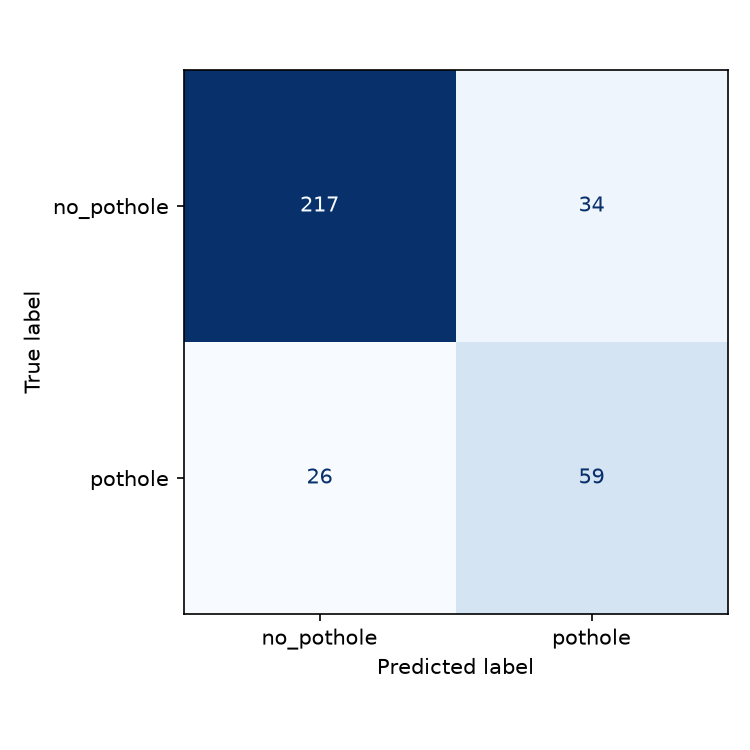

# Pothole Detection CNN

A convolutional neural network, trained from scratch in PyTorch, that classifies
road-surface photographs as containing a **pothole** or **no pothole**.

## Overview

Potholes are one of the most common and costly forms of road damage, and manual
inspection doesn't scale to an entire city's street network. This project trains
a small CNN to flag potholes automatically from street-level photographs, as a
first step toward automating that inspection process.

The harder (and more useful) version of this problem isn't "pothole vs. a perfect
road" — it's telling a pothole apart from other pavement defects like cracks,
which look visually similar (dark, irregular regions on asphalt). This project
deliberately uses that harder framing: the negative class contains real
pavement cracks, not just clean road.

## Dataset

[Cracks and Potholes in Road Images Dataset](https://github.com/biankatpas/Cracks-and-Potholes-in-Road-Images-Dataset)
(Passos et al., 2020) — 2,235 road-surface photographs captured by a Highway
Diagnostic Vehicle for Brazil's National Department of Transport Infrastructure
(DNIT), each shipped with a pixel-level pothole annotation mask. MIT licensed.

`scripts/prepare-dataset.py` derives the binary classification label for each
image directly from its mask (pothole present / not present) and sorts the
images into `data/pothole/` and `data/no_pothole/`:

| class | images |
|---|---|
| pothole | 564 |
| no_pothole (incl. crack-only roads) | 1,671 |

The raw dataset isn't committed to this repo. The preparation script accepts
either a local copy of the dataset or downloads it automatically.

```bash
# Use a local dataset copy (the folder should contain SampleXX folders)
python scripts/prepare-dataset.py --source "D:\v1"

# Or download the public dataset automatically
python scripts/prepare-dataset.py
```

## Model

A residual CNN trained entirely from scratch (no pretrained weights):

```
Residual convolutional stages (3->32->64->128 channels)
Global Average Pooling -> Dropout -> small classifier
```

Input images are resized to 160x160 and normalized with ImageNet statistics.
Training uses moderately class-weighted cross-entropy, AdamW, augmentation, and
early stopping on validation loss. A pothole threshold is selected on the
validation split to maximize F1; the test split remains reserved for evaluation.
See [src/model.py](src/model.py) and [src/train.py](src/train.py).

Data is split 70 / 15 / 15 (train / val / test), stratified by class, with a
fixed random seed for reproducibility.

## Results

The current scratch-CNN checkpoint scored the following on a held-out test set
of 336 images:

| metric | value |
|---|---|
| Decision threshold | 0.301 |
| Accuracy | 0.821 |
| Precision | 0.634 |
| Recall | 0.694 |
| F1 | 0.663 |
| ROC-AUC | 0.842 |




The decision threshold was selected on the validation split to maximize F1;
the test split was held out for final evaluation. Results may vary with a
different dataset or split. Running `python src/evaluate.py` updates
`results/metrics.json` and the confusion matrix; update this table manually if
you want the README to reflect a newly trained checkpoint's metrics.

## Project structure

```
pothole-detection/
├── data/                         # generated dataset; not committed
│   ├── no_pothole/               # road images without potholes
│   └── pothole/                  # road images containing potholes
├── models/
│   └── best_model.pt             # best checkpoint from training
├── results/
│   ├── confusion_matrix.png      # test-set confusion matrix
│   ├── history.json              # per-epoch training and validation history
│   ├── metrics.json              # latest test-set metrics
│   └── training_curves.png       # loss and accuracy curves
├── scripts/
│   └── prepare-dataset.py        # prepares labeled image folders from source data
├── src/
│   ├── dataset.py                # loading, transforms, and stratified data split
│   ├── model.py                  # scratch-trained residual CNN
│   ├── train.py                  # training, checkpointing, and threshold selection
│   ├── evaluate.py               # held-out test metrics and confusion matrix
│   └── predict.py                # inference on one road image
├── requirements.txt              # Python dependencies
└── README.md
```

## Usage

### Run on Windows (PowerShell)

Open PowerShell and change to the project folder:

```powershell
cd D:\RideSafe\pothole-detection
```

Create and activate a virtual environment, then install dependencies:

```powershell
python -m venv .venv
.\.venv\Scripts\Activate.ps1
python -m pip install --upgrade pip
python -m pip install -r requirements.txt
```

If PowerShell blocks activation, allow it for the current terminal session and
activate again:

```powershell
Set-ExecutionPolicy -Scope Process -ExecutionPolicy Bypass
.\.venv\Scripts\Activate.ps1
```

Prepare the dataset. If your dataset is already at `D:\v1`, use that path;
otherwise omit `--source` to download it:

```powershell
python scripts\prepare-dataset.py --source "D:\v1"
# Or download the dataset:
python scripts\prepare-dataset.py
```

Train the scratch CNN, evaluate it on the held-out test split, and predict from
an original road photo (the `*_RAW` image, not a lane/crack/pothole annotation):

```powershell
python src\train.py --epochs 50
python src\evaluate.py
python src\predict.py "D:\v1\SampleXX\image_RAW.jpg"
```

Training saves the best validation-loss checkpoint to
`models\best_model.pt`, selects a decision threshold using only validation data,
and writes the training history and curves under `results\`. Evaluation writes
the test metrics and confusion matrix there. The first run of training can take
a while, especially on CPU.

## Citation

If you use the underlying dataset, please cite:

> Passos, B.T., Cassaniga, M.J., Fernandes, A.M.R., Medeiros, K.B., Comunello, E.
> "Cracks and Potholes in Road Images Dataset." University of Itajaí Valley (UNIVALI), 2020.
